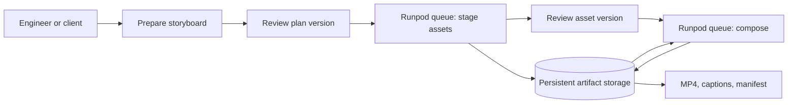

# Architecture

## Problem and first release

OpenMontage is an instruction-driven video-production toolkit: an agent normally reads its pipeline and stage instructions, makes creative decisions, calls tools, and asks for approval. Copying the repository into a container does not turn that interactive workflow into a queue worker.

This project introduces a narrow serverless boundary: execute an already specified and approved production task. The first release accepts a structured storyboard and supplied assets, stages the media, and renders through the existing Remotion `Explainer` composition. Plain-script planning and GPU-generated assets are separate capabilities, not assumptions hidden in a demo.

Proposed service envelope: up to eight scenes and 90 seconds. The schema and tests are the authority for the implemented limits.

## Request flow

The client holds no expensive worker while a person reviews a plan. Each submitted job performs bounded work and returns persistent artifact references. Runpod's queue manages scheduling; it is not the production database.

## Responsibilities and state

| Component | Responsibility | State |
|---|---|---|
| Preparation/client | Submit validated input and record explicit approval for a version | Request and approval metadata |
| Worker handler | Validate job, dispatch an allowed operation, produce structured output | Temporary job context |
| Production runner | Stage inputs, create composition props, invoke rendering, validate output | Recoverable checkpoints |
| Remotion composer | Turn approved props/media into frames and MP4 | Temporary rendering workspace |
| FFmpeg caption pass | Burn explicitly timed phrase subtitles with wrapping; preserve supplied audio | Temporary media output |
| Artifact storage | Keep plans, inputs, outputs and completion metadata across worker shutdowns | Durable |
| Runpod endpoint | Schedule container workers and enforce resource/time limits | Queue state with bounded retention |

The actual cloud deployment uses the filesystem adapter on the user's persistent Runpod network volume at `/runpod-volume/openmontage`. The same adapter can use an ordinary local directory during development, but a directory on disposable container disk is not durable. A startup guard checks the required mount before serving jobs. The successful cloud workflow persisted plans/assets across observed worker IDs and its output was read back independently.

Runpod's regional S3 API is an **external authenticated transfer path** to that volume: it uploaded inputs and downloaded all five verified outputs. The worker itself does not use S3 credentials for its filesystem operations. The optional generic S3 adapter is a different deployment profile, relying on conditional object creation and presigned downloads; those generic-provider semantics remain unverified. Existing sibling LLM/model files were not listed or deleted.

## Approval, retries, and concurrency

Approvals bind to the version or content hash reviewed. A changed storyboard needs a new approval. Asset approval identifies the staged assets, preventing a later composition from using an unrelated set.

Idempotency protects the same logical request from producing conflicting results when a client retries. Persisted completion metadata and artifact validation determine whether completed work can be reused. A project lock prevents overlapping writes. A test that mocks rendering can prove control flow; a real interruption/restart test is needed to prove recovery of media work.

Begin with one concurrent production per worker and one maximum worker in validation. This bounds resource contention and simplifies diagnosis. It does not establish multi-worker safety; distributed locking and a concurrent execution test must be verified before scaling.

The provider adapter is also a boundary that needs live testing. Local errors are structured dictionaries; the 0.1.2 Runpod handler serializes sanitized `{code,message}` into an error string required by the platform transport. An earlier intermediate-SDK test missed a live failure: 0.1.1 lost the dictionary and returned outer `COMPLETED`. Full wire-path tests cover this locally, and actual 0.1.2 retests verified provider `FAILED` with the diagnostic plus a fresh normal `COMPLETED` prepare. Successful media output and failure-status correctness are distinct acceptance checks, both recorded with their version provenance.

## Runtime and security boundaries

The Linux image contains the application, pinned upstream source, Node, rendering browser, FFmpeg/ffprobe, Python dependencies, and fonts. After visual QA found phrase clipping, wrapper 0.1.1 adds an FFmpeg/libass caption burn pass after Remotion composition. It uses the supplied phrase timings, wraps long cues and does not fabricate word alignment. This is caption postprocessing, not a silent switch to another composition runtime. Final visual retest is recorded separately. Assets and optional model weights are separate from source code. Credentials are runtime configuration and must never be baked into image layers or committed to the public repository.

Inputs are data, not shell commands or arbitrary executable composition code. The worker must constrain file/object references, operation names, sizes, duration, and scene count. Network asset retrieval, if supported, needs explicit host/protocol and private-address protections. Do not claim those protections until tests cover the implementation.

## What must still be measured

Cold start, warm stage runtime, CPU/RAM/disk use, GPU VRAM when generation is added, cost per completed video, and visual/audio quality. A successful build or unit test is not evidence of retrieval quality, GPU compatibility, cloud availability, or cost savings.
