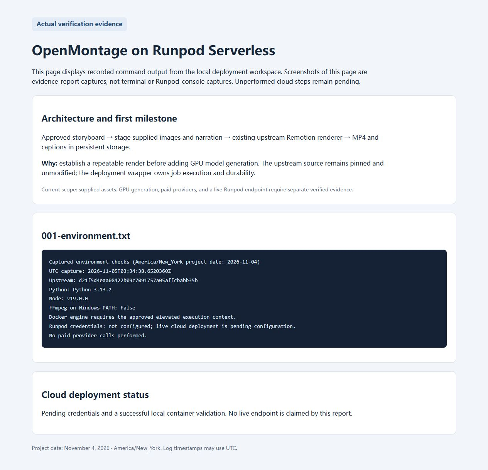
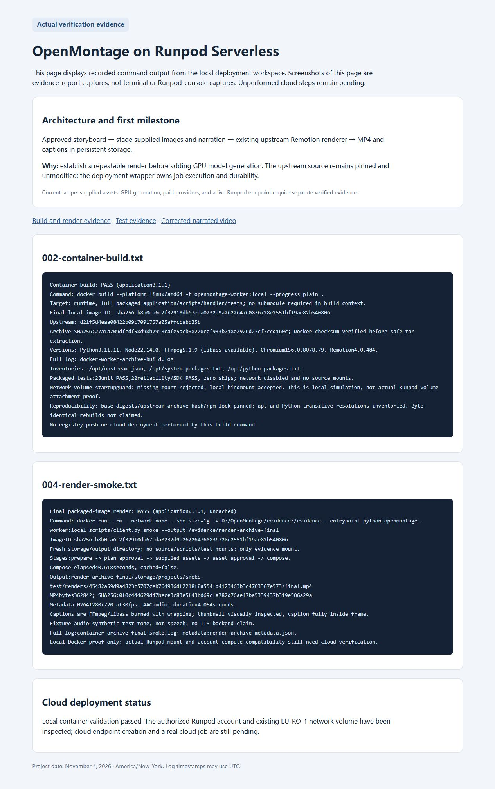
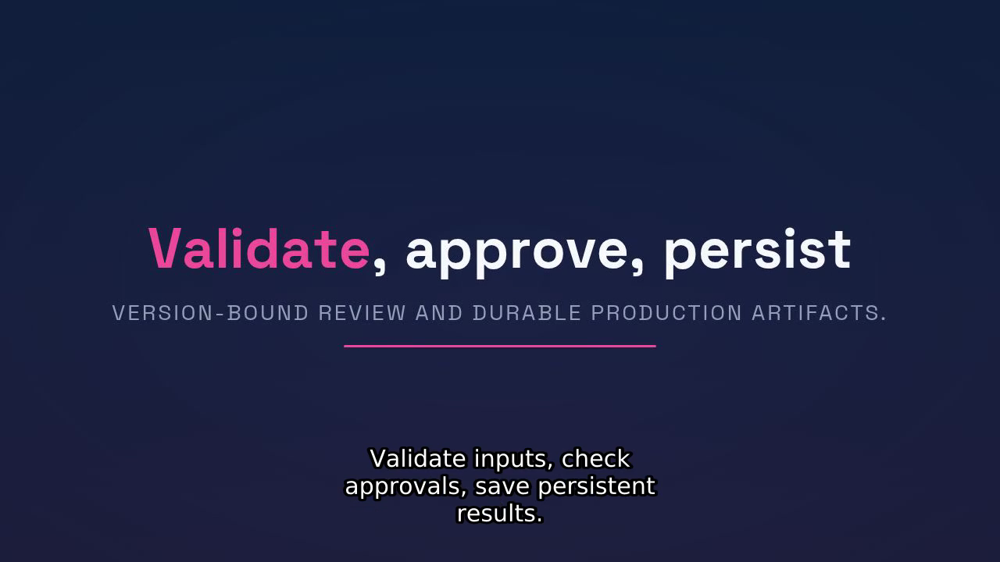
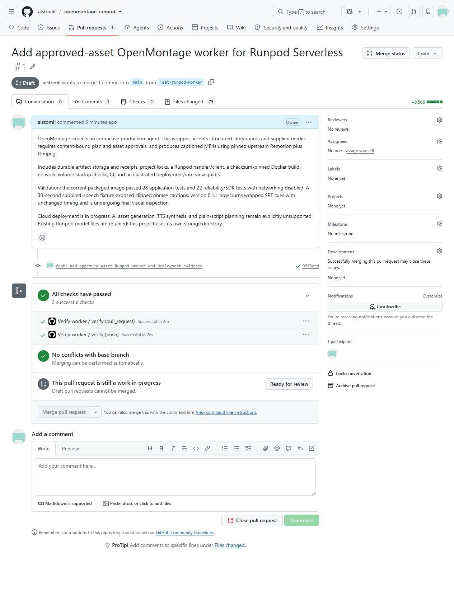
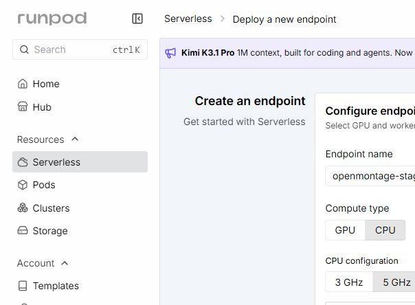
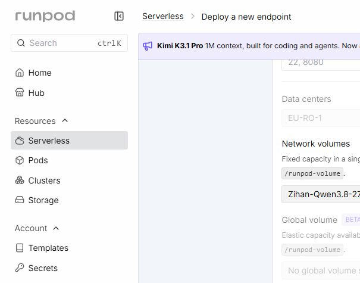
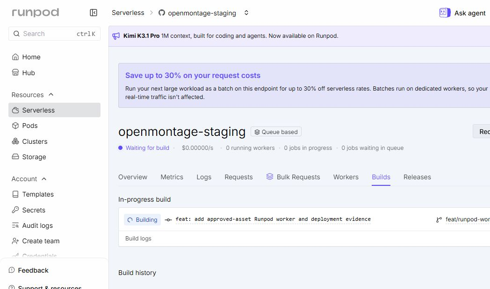

# Deployment walkthrough

This walkthrough separates actions already observed from commands prepared for validation. It describes the supplied-asset baseline. GPU model generation and a full autonomous creative agent are later milestones.

The full cloud stage chain completed on 0.1.1 and all five artifacts were downloaded with verified hashes. A live negative test then found an error-transport defect. The 0.1.2 correction passed 31 unit + 23 reliability checks, then actual provider invalid-input `FAILED` with the sanitized diagnostic and fresh normal prepare `COMPLETED` uncached. Follow [the executed live validation record](live-validation.md) for exact UI steps, private transfer setup, request/response files, version provenance and remaining limitations.

## 1. Understand the working copy

**Purpose:** Keep our deployment integration separate from upstream and know exactly which source version we build.

The recorded working copy is at `D:\OpenMontage` on branch `feat/runpod-worker`. For a new engineer, clone the implementation branch explicitly from a chosen parent directory:

```powershell
git clone --branch feat/runpod-worker --recurse-submodules https://github.com/alstomli/openmontage-runpod.git
Set-Location openmontage-runpod
```

The new checkout directory will be `openmontage-runpod`; use your actual root in subsequent commands. Default `main` still contains only the foundation and the draft PR remains unmerged for user review. OpenMontage is an unmodified Git submodule at `vendor/OpenMontage`. Its expected commit is recorded in `UPSTREAM.json`.

From the wrapper root:

```powershell
git branch --show-current
git submodule status
python scripts/verify_upstream.py
```

For a fresh clone of the published wrapper, initialize its submodule before building:

```powershell
git submodule update --init --recursive
```

**Expected result:** The upstream verifier accepts commit `d21f5d4eaa08422b09c7091757a05affcbabb35b`. A mismatch is a reason to stop and inspect the dependency, not silently move the pin.

The implementation is on `feat/runpod-worker`; the successful cloud video used 0.1.1 commit `95f5ecd`, and the latest error-adapter correction is 0.1.2 commit `5a69307`. `main` initially contains the foundation only. Select the intended verified commit/release rather than assuming every branch head has passed cloud gates. Docker independently fetches upstream commit archive SHA-256 `27a1a709dfcdf58d98b2918cafe5acb88220cef933b718e2926d23cf7ccd160c`, so a Runpod source build does not depend on recursive submodule checkout. The local submodule remains useful for inspection and CI pin verification.

**Observed:** The coordinator cloned the public source and registered the pinned submodule. See [environment log](../evidence/logs/001-environment.txt).



*This is a browser screenshot of the evidence report displaying real command observations. It is not a screenshot of a terminal, a successful render, or the Runpod console.*

## 2. Verify Docker and build the Linux runtime

**Purpose:** Run the same dependency stack locally and on Runpod, independent of Windows Node/FFmpeg installation.

Prerequisites are Git with the initialized submodule, a working Docker Linux engine, registry/package-network access, and enough disk for the image and rendering scratch. The initial workstation had Windows Node 19 and no FFmpeg on PATH; these are supplied inside the container.

```powershell
docker version
docker build --platform linux/amd64 -t openmontage-worker:local .
```

The image contains Python, Node, Chromium, FFmpeg/ffprobe, fonts, the wrapper and the pinned upstream composer. It uses Remotion concurrency 1 initially. The CPU supplied-asset image does not contain a validated GPU-generation model.

**Verification:** A successful Docker build produces the image; it does not prove rendering. Record the image identity and installed package inventories as part of release evidence. Base images/upstream/npm lockfile are pinned. Debian package resolution and Python transitive dependencies are not fully frozen, so this is not a bit-for-bit reproducibility claim.

**Observed:** The archive-built 0.1.1 image passed 28 unit plus 22 reliability checks, mount-guard checks and a four-second offline render. Its separate local and live cloud 30-second supplied-speech outputs were inspected for captions/subtitles, with a known cosmetic title-word-wrap limitation. The later transport-only 0.1.2 exact image passed 31 unit + 23 reliability checks with no source mounts/network; media code is unchanged, so those existing renders retain 0.1.1 provenance. See [the evidence index](../evidence/index.md).



*Browser screenshot of the local evidence report summarizing actual retained logs. The report is an index of results, not an original terminal or Runpod worker screen.*

## 3. Verify the execution contract and real rendering

**Purpose:** Catch input/approval/retry defects separately from browser and media failures.

```powershell
docker run --rm --entrypoint python openmontage-worker:local -m unittest discover -s tests/unit -v
docker run --rm --entrypoint python openmontage-worker:local -m unittest discover -s tests/reliability -v
$output = (New-Item -ItemType Directory -Force evidence/local-smoke).FullName
docker run --rm --network none --shm-size=1g --mount "type=bind,source=$output,target=/evidence" --entrypoint python openmontage-worker:local scripts/client.py smoke --output /evidence
```

The smoke fixture performs a real render with a four-second tone and supplied image. Retain its MP4, manifest, logs and representative frame. It proves the media execution path, not speech synthesis, automatic caption timing or general visual quality. Unit mocks alone do not satisfy this step. The exact local and remote CLI sequence, input limits and example-file replacements are in [Request contract](request-contract.md).

The application entry point accepts one JSON request file:

```powershell
python -m pip install -e .
python -m openmontage_worker request.json
```

Inside the built image, the package is already installed. Requests use an `input` envelope containing `operation`, `project_id`, `idempotency_key` and operation-specific fields. The implemented stage sequence is:

| Operation | Required stage data | Result |
|---|---|---|
| `prepare` | Structured storyboard | Plan artifact hash |
| `approve` | `stage: "plan"`, exact `artifact_hash`, `approved: true` | Plan approval |
| `generate_assets` | Approved plan hash | Staged asset artifact hash |
| `approve` | `stage: "assets"`, exact `artifact_hash`, `approved: true` | Asset approval |
| `compose` | Approved asset hash | Rendered output references |

Storyboards have title, one to eight scenes with text/duration and optional image, supplied narration `{key, sha256}`, explicit timed captions, dimensions and theme. Source objects must live under `inputs/{project_id}/…` in configured storage. Job input does not accept arbitrary URLs or host paths. Read the checked-in schema/examples for exact field names.

The baseline explicitly does not implement plain-script planning, GPU image generation or Piper TTS. Narration and caption timing are supplied. This allows a real media test without implying unimplemented generation features.

Review the storyboard version, stage supplied assets, review the asset version, and compose. Human review happens between submissions. A technical fixture's automatic approvals demonstrate protocol execution; they do not constitute a production user's approval.

**Acceptance:** Playable MP4, expected duration/dimensions/audio, caption artifacts, output hashes and tested rejection of stale approvals.

Do not stop at ffprobe. In our first 30-second narrated test, streams/duration passed but a captured frame showed an overflowing phrase caption. The adapter was treating a whole phrase as a nowrap word. The [visual QA finding](../evidence/index.md#visual-qa-finding-valid-mp4-can-still-be-wrong) records the defect and retest status. Also inspect whether scene subtitles and text remain visible.



*Actual frame from the corrected 30-second local integration test. Caption phrases remain supplied and manually timed. The source-code mount used for this longer fixture is recorded separately from the packaged-image smoke test; no cloud execution is implied.*

## 4. Configure durable production storage

**Purpose:** Preserve artifacts when the worker scales down or is replaced.

Local development uses `STORAGE_BACKEND=local` and a mounted/persistent `LOCAL_STORAGE_ROOT`. Cloud operation needs persistence outside disposable container disk. Choose one verified profile: a mounted Runpod network volume using the filesystem adapter, or a generic S3 provider compatible with the adapter. Set configuration through the deployment environment; `.env.example` is a name/reference list, not an automatically loaded file.

For a network volume set `STORAGE_BACKEND=local`, `LOCAL_STORAGE_ROOT=/runpod-volume/openmontage` and `REQUIRE_NETWORK_VOLUME=1`. Use the image's normal startup entry point so its mount/writability guard runs. Verify actual persistence and region/compute compatibility first. The worker owns only this subdirectory; preserve sibling LLM/model files. Returned `local_path` values are inside the worker, so input/output transfer needs authenticated volume tooling or the documented Runpod file-transfer API. Do not present those paths as public download URLs.

For generic S3 use these settings:

| Variable | Meaning |
|---|---|
| `STORAGE_BACKEND=s3` | Enable generic S3 adapter; do not use for Runpod volume S3 API |
| `S3_BUCKET` / `S3_PREFIX` | Bucket and object namespace |
| `S3_ENDPOINT_URL` | Optional provider endpoint |
| `AWS_DEFAULT_REGION` | Provider region |
| `AWS_ACCESS_KEY_ID` / `AWS_SECRET_ACCESS_KEY` | Runtime credentials; never commit values |
| `OPENMONTAGE_ROOT` | Upstream code path inside image |
| `WORK_ROOT` | Temporary worker scratch directory |
| `INPUT_ROOT` | Unused compatibility setting; job inputs are constrained storage keys |
| `COMPOSER_BROWSER_EXECUTABLE` | Browser path in the image |
| `REMOTION_CONCURRENCY=1` | Compatibility setting; renderer currently hardcodes parallelism 1 |

Verify read/write and conditional-create behavior using the actual generic provider before claiming S3 compatibility. In particular, S3 project locks rely on conditional object creation, and the adapter returns presigned links. Runpod's volume S3 API does not meet the same assumed contract, so its deployment profile mounts the volume instead. Keep input and output files in the application-owned namespace. Do not expose storage publicly merely to make a demo work.

**Observed:** The existing NETWORK volume `l34ba8wnno`, 60 GB in `EU-RO-1`, is attached to the CPU endpoint and used successfully by cloud jobs. Its filesystem adapter writes only `/runpod-volume/openmontage`; existing model contents were retained. The existing Runpod API key remains masked/unused because Requests UI submitted the jobs. For external file transfer, the user explicitly approved creation of an S3 read/write key at action time; values are only in ignored local `.env`, injected through Docker `--env-file .env`. The application does not auto-load that file. Two inputs were uploaded/read back and five outputs downloaded/hash-verified through the regional volume S3 API. This does not validate the separate generic S3 locking/presigned adapter. See [private setup and exact transfer commands](live-validation.md#1-prepare-a-private-transfer-environment).

## 5. Choose source deployment or prepare an image deployment

**Purpose:** Give Runpod the verified source/image and retain an exact release identity.

### Primary route: connected GitHub build

The existing Runpod GitHub connection can select [alstomli/openmontage-runpod](https://github.com/alstomli/openmontage-runpod). In Serverless, create a queue endpoint from that repository, select the implementation branch `feat/runpod-worker` and root `Dockerfile`, and configure the verified storage/compute settings. Runpod builds the image itself. The checksum-pinned source archive avoids a dependency on the builder initializing the Git submodule. Retain the chosen wrapper commit and actual Runpod build/image identity when available.

This route does not require first publishing to GHCR. Selecting a repository is only a configuration step, not evidence that its build or a job succeeded.

### Alternative route: publish an immutable image

Publish the image to your chosen registry using its normal authenticated workflow, then obtain the immutable `@sha256:…` digest reference. A mutable `latest` tag alone is insufficient to identify a tested release.

The checked-in `publish.yml` is manual (`workflow_dispatch`) and builds/tests the candidate before GHCR push. It names a GitHub `release` environment; the YAML alone does not create required reviewers. Configure environment reviewers in GitHub if that approval gate is desired. The normal CI workflow builds/tests and retains evidence, but does not deploy to Runpod. The manual registry-publish workflow has not been claimed as executed.

The PR interface now shows two successful CI checks, one from push and one from the PR. Each verification job runs the configured unit/reliability suites and offline render; this is two workflow results, not fifty separate GitHub status checks. Registry publication remains separate.



Generate a local review plan, replacing the bracketed example values with real verified values:

```powershell
python scripts/prepare_deployment.py --image "ghcr.io/OWNER/REPO@sha256:REPLACE_WITH_64_HEX_DIGEST" --network-volume-id "VERIFIED_VOLUME_ID" --data-center "VERIFIED_DATACENTER" --cpu-flavor "CONFIRMED_RUNPOD_CPU_FLAVOR" --output deployment/plan.json
```

The digest placeholder is deliberately rejected until replaced. This script makes **no API calls**. It prepares template and endpoint payloads against Runpod REST v1, with CPU compute by default for this CPU-render baseline. Confirm the CPU flavor is available and can attach the volume in its datacenter, then inspect current pricing before creating the endpoint. For generic S3, replace `--network-volume-id`/`--data-center` with `--bucket` and optional `--s3-endpoint`. An explicit GPU compute option exists for account/resource compatibility; selecting it does not enable AI generation or demonstrate GPU acceleration.

Starting settings are active workers 0, maximum workers 1, one job per worker, 20-minute execution ceiling, and one-hour request TTL. These are initial policy values, not measured service-level guarantees. Runtime credentials and Runpod client credentials are configured separately; do not paste them into versioned plans.

## 6. Deploy staging and exercise an async job

**Purpose:** Verify cloud execution, credentials, storage and output retrieval together.

Create the reviewed queue endpoint through connected GitHub source deployment or a published image/template. Record the actual endpoint ID, source commit/build/image identity, selected resources, environment variable names, worker settings and timeout values. Capture resource-configuration screenshots without financial headers, credential fragments or secret values.

The deployed configuration is CPU General Purpose 5 GHz, 4 vCPU / 16 GB RAM, maximum workers 1, active workers 0, execution timeout 1,200 seconds, idle timeout 5 seconds and container disk 20 GB with the existing `EU-RO-1` volume. Storage environment is `STORAGE_BACKEND=local`, `LOCAL_STORAGE_ROOT=/runpod-volume/openmontage`, `REQUIRE_NETWORK_VOLUME=1`. Initially only the form was verified; subsequent ready workers, persisted plans and downloaded cloud output established actual scheduling/mount use for this profile.





The initial successful-media source was `feat/runpod-worker` at `95f5ecdf99e8daccf0225c45e9c6c771b979503a`, root `Dockerfile`. The static handler warning did not recognize the wrapper entry point; source/SDK review allowed continuation, but later negative testing still proved necessary. An onboarding overlay initially covered Deploy; dismissing it exposed the control. [openmontage-staging](https://console.runpod.io/serverless/user/endpoint/aocbogtvk098ds), ID `aocbogtvk098ds`, progressed from building to **Ready / build Completed** and ran the full media workflow. Retained cloud build logs identify a separately built image, not the local image digest. The separate 0.1.2 build from `5a69307` completed and passed its live invalid-input/normal-prepare tests without repeating unchanged media generation.



Use asynchronous `POST /v2/{endpoint_id}/run` for production-stage jobs and poll `GET /v2/{endpoint_id}/status/{job_id}`. The exact `input` comes from the wrapper examples. Keep API keys in local runtime configuration, not example JSON or screenshots.

Alternatively use the authenticated endpoint Requests UI, as this run did, to submit each full JSON and retain its response without recovering/creating a Runpod API key. Follow prepare → approve plan → stage supplied assets → approve assets → compose, reviewing each returned hash. [The executed request table](live-validation.md#3-submit-each-stage-in-the-requests-ui) links the actual files.

Download the resulting MP4 from durable storage, inspect playback/audio/captions, and compare its manifest to the approved plan/assets. Runpod queue-result retention is limited; store production results separately.

**Verified media result:** Cloud compose `1cdc79ce-3fbb-4458-b71c-3e66d4ba3852-u1` completed in 138,890 ms execution with 4,285 ms reported delay. Delay is not a pure cold-start measure. All five artifacts downloaded with matching hashes; MP4 1,829,646 bytes, 30.059 seconds, H.264 1280×720 at 30 fps / AAC. Actual cloud frames at 5/15/25 seconds show contained captions and subtitles. This is 0.1.1 media evidence.

**Transport correction verified:** Invalid input in 0.1.1 exposed a provider transport bug despite the successful video. The 0.1.2 adapter changes the platform error to sanitized JSON text while preserving local structured errors. Actual invalid input now returned provider `FAILED` with safe `invalid_input` / `Unknown operation.` diagnostic; a fresh normal prepare completed uncached with the expected plan hash. See [negative-path record and exact responses](live-validation.md#6-negative-path-finding-and-verified-012-correction). Hard-kill recovery, generic S3 locking, broader layout quality and GPU generation remain separate unverified capabilities.

## 7. Test recovery, release, and rollback

Follow the [runbook](runbook.md) to test duplicate requests, worker replacement and stale locks. Preserve artifacts across replacement. Do not remove a lock while the original writer might still run.

Retain the previous image digest/configuration before release. Demonstrate rollback with a smoke production and record its output. Hub publication is a separate later process requiring its own metadata, tests and review; a working endpoint alone does not mean a Hub listing exists.

## Official references

- [Runpod Dockerfile packaging](https://docs.runpod.io/serverless/workers/create-dockerfile)
- [Runpod GitHub deployment](https://docs.runpod.io/serverless/workers/github-integration)
- [Runpod storage](https://docs.runpod.io/serverless/storage/overview)
- [Queue requests and result retention](https://docs.runpod.io/serverless/endpoints/send-requests)
- [Endpoint configuration](https://docs.runpod.io/serverless/endpoints/endpoint-configurations)

The wrapper's dry-run plan does not replace validation against the actual account, API version and selected compute tier.
