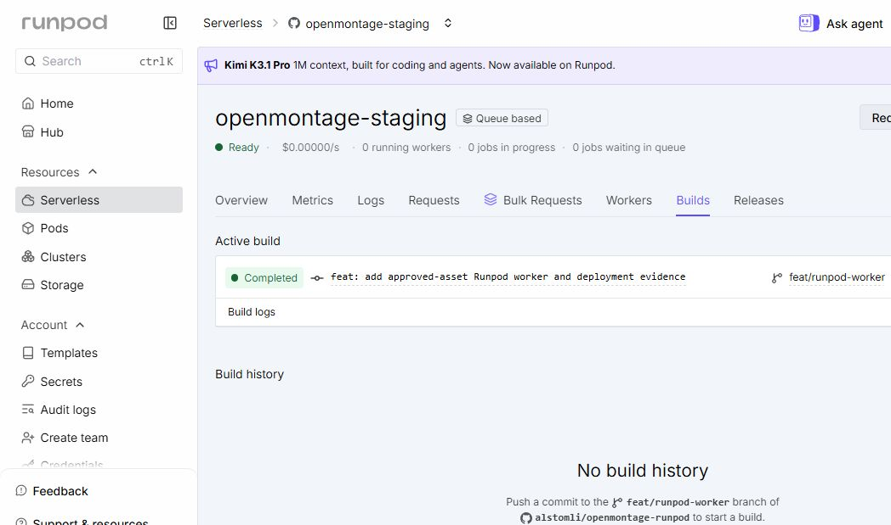
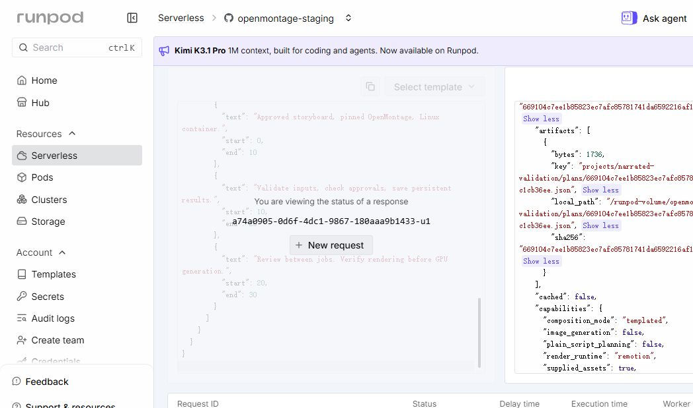
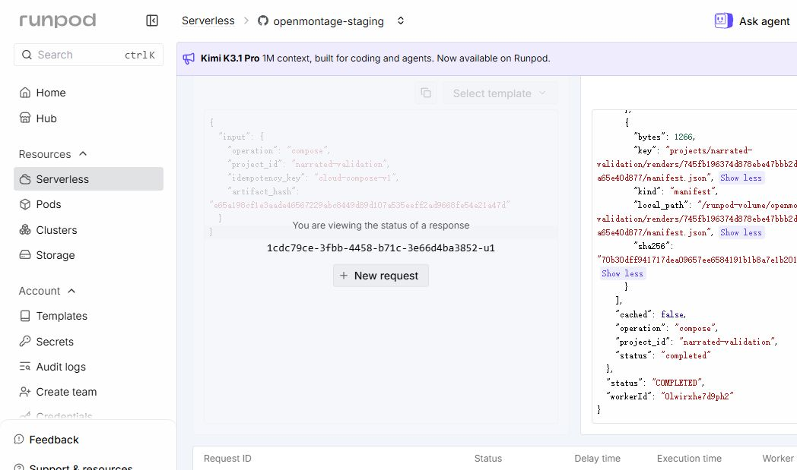
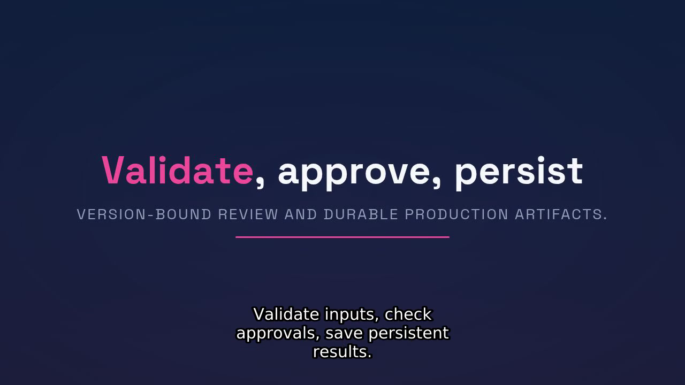
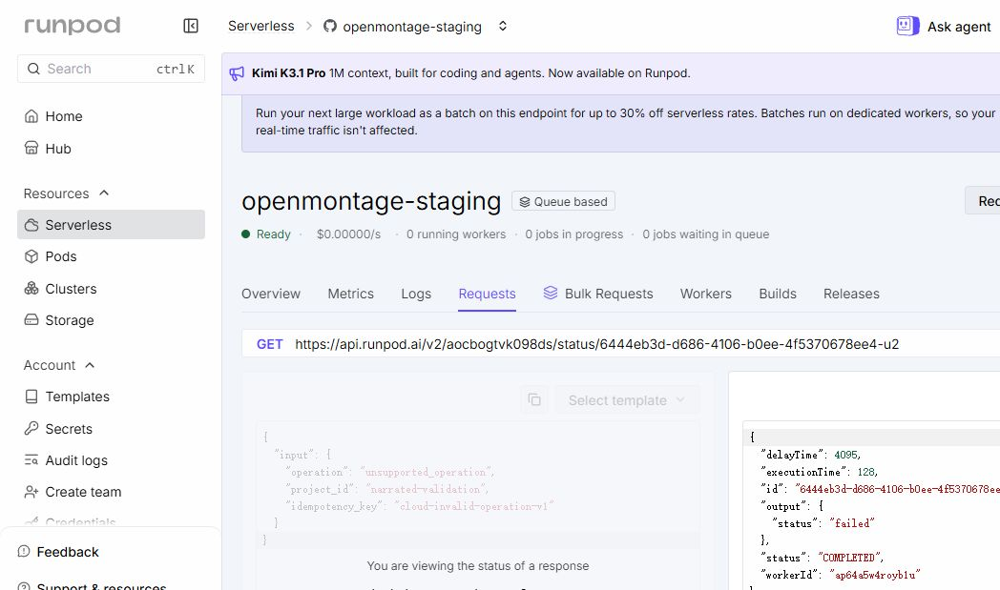

# Live Runpod deployment and validation record

This is the executed path for the first cloud prototype, not a generic promise that every deployment will behave identically. It distinguishes the successful **0.1.1 media workflow** from the **0.1.2 error-transport correction**, whose live invalid-input and normal-prepare checks both passed.

## Verified deployment identity

| Item | Observed value |
|---|---|
| Endpoint | [openmontage-staging](https://console.runpod.io/serverless/user/endpoint/aocbogtvk098ds), ID `aocbogtvk098ds` |
| Source for successful media test | `feat/runpod-worker`, commit `95f5ecdf99e8daccf0225c45e9c6c771b979503a`, wrapper 0.1.1 |
| Upstream | `d21f5d4eaa08422b09c7091757a05affcbabb35b` |
| Cloud manifest in build log | `sha256:4bc953785403c6ca7f7ec9d2e0174c44ff74574d82d73e257024131088eca8df` |
| Cloud registry tag | `registry.runpod.net/alstomli-openmontage-runpod-feat-runpod-worker-dockerfile_1446491806_54d096c39440b32a5bf8:95f5ecdf9` |
| Compute | CPU, General Purpose 5 GHz, 4 vCPU / 16 GB RAM |
| Scaling | Active 0, maximum 1; one application job at a time |
| Time/disk settings | Execution 1,200 seconds, idle 5 seconds, container disk 20 GB |
| Persistent storage | Existing NETWORK volume `l34ba8wnno`, 60 GB, `EU-RO-1`; owned directory `/runpod-volume/openmontage` |
| Required storage environment | `STORAGE_BACKEND=local`, `LOCAL_STORAGE_ROOT=/runpod-volume/openmontage`, `REQUIRE_NETWORK_VOLUME=1` |

The Runpod image was built independently from source. It is not the same image digest as the local Docker build, and byte-identical rebuilds are not claimed. Actual build logs are retained in [011-runpod-build.log](../evidence/logs/011-runpod-build.log).



## 1. Prepare a private transfer environment

The existing Runpod API key was masked and not recovered. Jobs were submitted through the authenticated Runpod Requests UI instead, so that API key was not needed for this run.

For file transfer, the user explicitly approved creation of an S3 key at action time. The Runpod form granted read/write across S3 volumes rather than a per-prefix scope; this broader permission was disclosed before confirmation. The new key was named `openmontage-deploy`. Its values were stored only in ignored local `.env`, never printed, committed or captured in screenshots. The worker itself uses the attached filesystem volume, not those transfer credentials.

[Permission-scope review screenshot](../evidence/screenshots/010-s3-key-permission-review.jpg) records the account form's scope without credential values. It is not a screenshot of the created secret.

Provide these variable names in a private local `.env` using authorized values:

```text
AWS_ACCESS_KEY_ID=<authorized transfer key>
AWS_SECRET_ACCESS_KEY=<authorized transfer secret>
AWS_DEFAULT_REGION=EU-RO-1
S3_ENDPOINT_URL=https://s3api-eu-ro-1.runpod.io
S3_BUCKET=l34ba8wnno
```

Do not copy real values into the public documentation or example requests. `.env` is not automatically loaded by the application. In this record Docker injects it explicitly with `--env-file .env`. The transfer helper is intentionally restricted to the approved volume and the `narrated-validation` fixture; adapt it through a reviewed change for another project instead of treating it as a general-purpose bulk data tool.

## 2. Upload the two supplied assets and verify readback

Prerequisite: the local narrated fixture exists under `evidence/narrated-fixed` with `results.json`, input references and storage files. These are generated validation artifacts, so a fresh clone needs the fixture recreated or its own supplied assets imported. See the local walkthrough and `scripts/client.py upload` for the normal operator interface.

The actual transfer uses:

```powershell
$evidence = (Resolve-Path evidence).Path
docker run --rm --env-file .env --mount "type=bind,source=$evidence,target=/evidence" --entrypoint python openmontage-worker:local /evidence/fixtures/transfer_volume.py upload
```

The helper reads the approved local image/audio references, verifies their source SHA-256 values, uploads only `openmontage/inputs/narrated-validation/…`, downloads each object, and checks its SHA-256 again. It writes `evidence/cloud/prepare.json` and `inputs-transfer.json`. It does not list or delete sibling LLM/model contents.

**Observed:** Two objects uploaded and read back with matching hashes. [Transfer log](../evidence/logs/012-cloud-input-transfer.txt), [object record](../evidence/cloud/inputs-transfer.json). All existing model files were retained.

## 3. Submit each stage in the Requests UI

Open the endpoint's Requests tab. Paste one entire request JSON, submit it, retain the returned job response, and wait for completion before sending a dependent stage. Use fresh idempotency keys for a distinct run. The fixture uses supplied media and explicit approval records; no provider generation is hidden behind these operations.

| Order | Request | Retained response | Check before advancing |
|---|---|---|---|
| 1 | [prepare.json](../evidence/cloud/prepare.json) | [prepare-response.json](../evidence/cloud/prepare-response.json) | Outer job completed; application `awaiting_approval`; returned plan hash matches saved plan |
| 2 | [approve-plan.json](../evidence/cloud/approve-plan.json) | [approve-plan-response.json](../evidence/cloud/approve-plan-response.json) | Exact reviewed plan approved |
| 3 | [generate-assets.json](../evidence/cloud/generate-assets.json) | [generate-assets-response.json](../evidence/cloud/generate-assets-response.json) | Supplied media validated and staged; returned asset hash |
| 4 | [approve-assets.json](../evidence/cloud/approve-assets.json) | [approve-assets-response.json](../evidence/cloud/approve-assets-response.json) | Exact reviewed asset manifest approved |
| 5 | [compose.json](../evidence/cloud/compose.json) | [compose-response.json](../evidence/cloud/compose-response.json) | Outer and application completion; output references present |

The first live prepare was job `a74a0905-0d6f-4dc1-9867-180aaa9b1433-u1`, completed on worker `ap64a5w4royb1u`. The worker-written plan was read back through the S3 transfer API and its hash verified. To reproduce that check after retaining the UI response as `prepare-response.json`:

```powershell
docker run --rm --env-file .env --mount "type=bind,source=$evidence,target=/evidence" --entrypoint python openmontage-worker:local /evidence/fixtures/transfer_volume.py verify-plan
```



## 4. Confirm cloud composition and download all outputs

Live compose job `1cdc79ce-3fbb-4458-b71c-3e66d4ba3852-u1` completed on worker `0lwirxhe7d9ph2`. Its `executionTime` was 138,890 ms. `delayTime` was 4,285 ms; this includes queue/scheduling/startup behavior and is **not a pure cold-start measurement**.



After retaining the compose response, download through the same authorized transfer environment:

```powershell
docker run --rm --env-file .env --mount "type=bind,source=$evidence,target=/evidence" --entrypoint python openmontage-worker:local /evidence/fixtures/transfer_volume.py download
```

The helper downloads only `final.mp4`, `captions.srt`, `thumbnail.png`, `props.json` and `manifest.json` from this project's render namespace. All five SHA-256 values matched the worker response. [Download verification](../evidence/cloud/download-verification.json).

The cloud MP4 is **1,829,646 bytes**, SHA-256 `74dcd3ea89dad436dfb14ad5d9562d5a964a0eec149ec68896dd7c9a42e3b29d`, H.264 1280×720 at 30 fps with AAC audio, duration 30.059 seconds. [Media verification](../evidence/cloud/media-verification.json).

Coordinator inspected actual cloud frames at [5 seconds](../evidence/screenshots/cloud-render-05s.png), [15 seconds](../evidence/screenshots/cloud-render-15s.png) and [25 seconds](../evidence/screenshots/cloud-render-25s.png). Captions stayed inside the frame and subtitles were visible. The known upstream per-character title animation can still wrap within a word. This is a working technical prototype, not a universal creative-quality benchmark.

The [browser preview screenshot](../evidence/screenshots/015-cloud-output-preview.jpg) shows the downloaded cloud output in the local evidence viewer. It is playback evidence for the cloud-generated file, not a Runpod worker desktop capture.



## 5. Verify persistence and caching without overstating recovery

A matching prepare replay returned `cached: true`, execution 173 ms on the original worker. [Replay response](../evidence/cloud/prepare-replay-response.json). That establishes same-request reuse, not cross-worker recovery by itself.

The first prepare ran on `ap64a5w4royb1u`, while asset approval and composition ran on `0lwirxhe7d9ph2` and used the persisted plan/assets. Combined with external plan/output readback, this demonstrates persisted cross-job data across observed worker IDs on the mounted volume. It does not simulate a hard-killed writer, prove every concurrent race safe, or replace the stale-lock runbook.

## 6. Negative-path finding and verified 0.1.2 correction

The invalid-operation test against 0.1.1 returned outer Runpod `COMPLETED` with only `output: {"status":"failed"}`; the structured error object was lost. [Actual response](../evidence/cloud/invalid-operation-response.json). This was a deployment defect even though successful media jobs worked.



Earlier SDK-level tests exercised an intermediate error-extraction function, but did not verify the serialized payload at the transport boundary. The strengthened SRE regression drives the real pinned SDK path through `rp_job.handle_job` → `rp_http.send_result` → `_handle_result` and captures the JSON at a mocked `_transmit`; it demonstrates why the old test was insufficient.

Wrapper **0.1.2**, feature commit `5a69307`, serializes only sanitized `{code,message}` as a **JSON string** in the platform `error` field. Local `execute` and CLI results retain the structured dictionary. No traceback is returned. The exact packaged image `sha256:88cc4fe198b518659ca0450ce07e9f1a9aa1691f4a814aec3c527dfaaaf66252` passed **31 unit + 23 reliability tests**, offline with no source mounts. [Verification log](../evidence/logs/016-0.1.2-handler-verification.txt).

**Live changed-boundary gate passed:** The 0.1.2 fix build completed from `5a69307`. New invalid-operation job `f05f1304-0659-4c49-82a3-1fece3f50b1d-u2` returned provider **`FAILED`**, execution 235 ms, reported delay 4,806 ms, with this error string preserved:

```json
"{\"code\": \"invalid_input\", \"message\": \"Unknown operation.\"}"
```

[Actual negative response](../evidence/cloud/invalid-operation-v012-response.json), [corrected provider screenshot](../evidence/screenshots/017-live-error-corrected.jpg), [completed fix build screenshot](../evidence/screenshots/016-runpod-error-fix-build.jpg).

Fresh valid prepare job `a426eee3-aaeb-4589-b031-775ccfcd9a49-u1` then returned **`COMPLETED`**, application `awaiting_approval`, `cached: false`, expected plan hash `669104c7ee1b85823ec7afc85781741da6592216af138d71774db61fc1cb36ee`. It ran on worker `64drlvc6ms55j7`, execution 206 ms, reported delay 56,462 ms. [Actual success response](../evidence/cloud/prepare-v012-response.json), [success UI screenshot](../evidence/screenshots/018-live-success-after-fix.jpg).

The final screenshot shows no running/queued jobs and may show an initializing/idle worker lifecycle label; that label is not claimed as steady-state readiness. The retained job JSON establishes completion. Scale-to-zero after idle is expected with active workers 0. The [updated PR screenshot](../evidence/screenshots/019-pull-request-verified.jpg) is review evidence, not a substitute for provider responses.

[Final SRE cloud review](../evidence/logs/sre-cloud-review.txt) records a pass limited to this supplied-asset staging scope. Generic S3 worker semantics, a hard-killed lock owner, multi-tenant isolation, rollback demonstration, GPU generation and general creative quality remain outside that verification.

`media.py` is unchanged between the successful 0.1.1 cloud render and 0.1.2 transport correction. The prior cloud video remains 0.1.1 evidence; it is not relabeled as a 0.1.2 rerender. Another expensive media render is not required to test this isolated transport change unless a new concern appears.
