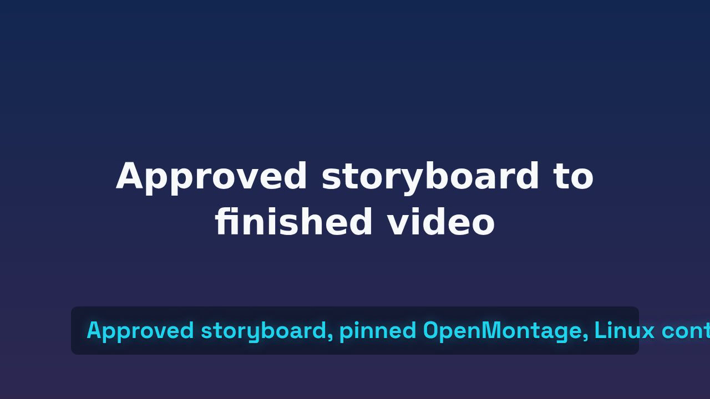

# Evidence index

This index links real artifacts and screenshots to claims. Missing evidence is stated explicitly. Screenshots supplement copyable commands and logs; they do not replace them.

## Current record

| ID | Important step | Evidence | What it proves | Status |
|---|---|---|---|---|
| E01 | Initial environment inspection | [Environment log](logs/001-environment.txt), [evidence-report screenshot](screenshots/001-local-baseline.jpg) | Observed versions and missing host tools | Retained; screenshot displays an evidence report, not terminal UI |
| E02 | Upstream clone and pin | `vendor/OpenMontage` HEAD `d21f5d4eaa08422b09c7091757a05affcbabb35b`, `UPSTREAM.json`, `.gitmodules` | Exact source baseline and submodule registration | Observed |
| E03 | Linux container build | [Build summary](logs/002-container-build.txt), `docker-worker-frozen-build.log` | Packaged runtime built | Verified prior image; caption-fix rebuild pending |
| E04 | Input validation and approval tests | [24 host unit tests](logs/003-unit-tests.txt), `container-unit-tests.txt`, [22 container reliability checks](logs/005-reliability-tests.txt), [SRE review](logs/sre-review.txt) | Tested validation, approvals, cache/recovery and pinned SDK behavior | Passed for prior packaged image; rerun required after caption fix |
| E05 | Supplied-asset render | [Four-second render summary](logs/004-render-smoke.txt), `render-final/smoke-results.json`, [30-second run log](logs/007-narrated-smoke.txt) | Real offline render/media validity; longer visual test found clipping | Four-second narrow proof passed; 30-second visual acceptance failed and fix in progress |
| E06 | Retry and replacement recovery | [Reliability suite](logs/005-reliability-tests.txt), [SRE review](logs/sre-review.txt) | Local persisted-artifact/new-runner recovery and idempotency cases | Passed tested local cases; real-provider S3 and hard-kill recovery remain unverified |
| E07 | Repository creation | [Public repository](https://github.com/alstomli/openmontage-runpod), [GitHub screenshot](screenshots/002-public-repository.jpg) | Public repository created and foundation published | Foundation `main` commit `f905958`; implementation push/review pending |
| E08 | Runpod endpoint configuration | Redacted console screenshot plus config | Actual endpoint settings | Pending |
| E09 | Async cloud job | Job ID, request, response and logs without credentials | Cloud execution completed | Pending |
| E10 | Durable output | Downloaded MP4/probe and storage object metadata | Output persists outside worker | Pending |
| E11 | Rollback/recovery demonstration | Version identifiers and before/after job result | Tested rollback procedure | Pending |
| E12 | Deployment dry-run | [Dry-run summary](logs/006-deployment-dry-run.txt), `logs/deployment-dry-run.json` | Plan generation with explicit dummy values; no API calls | Verified local script behavior, not resource provisioning |

## Visual QA finding: valid MP4 can still be wrong

The first 30-second narrated fixture exposed clipped captions in an actual frame despite valid ffprobe streams/dimensions/duration. The initial adapter passed entire phrase cues to upstream's word-caption component, whose no-wrap layout treated each phrase as one word. This is a real rendering defect and explains why screenshots/manual playback are release checks. Record the corrected implementation and successful visual retest before changing this acceptance status.



*Captured output frame before the fix. It proves this fixture's readability failure, not a general statement about every upstream composition. Correction and after-image verification remain separate evidence.*

## Screenshot checklist

Capture the actual selected settings and successful results. Each image needs a short caption naming the step, why it matters, code/image version, and the specific claim it supports.

1. Source baseline showing pinned commit and wrapper/vendor separation.
2. Successful image build and immutable image identity.
3. Contract/reliability test summary.
4. Finished video and representative frame; keep captions/audio verification separate.
5. Storage layout/checkpoint and retry/recovery result.
6. Public GitHub repository with no secret configuration visible.
7. Runpod endpoint worker, timeout, storage and image settings; mask sensitive values before capture.
8. Submitted job and successful completion with output references.
9. Download/playback of persistent MP4.
10. Failure diagnosis or rollback result where the demonstration actually occurred.

Do not fabricate terminal screenshots from invented output. A generated architecture figure is an explanatory diagram, not execution evidence. If a real screenshot cannot be safely captured, retain a redacted text log and mark the screenshot missing.

## Capture metadata template

```text
Evidence ID:
Captured at (America/New_York):
Wrapper commit / upstream commit / image digest:
Action and exact command (secrets omitted):
Expected outcome:
Observed outcome:
Artifact and screenshot paths:
Limitations:
Technical reviewer:
```
